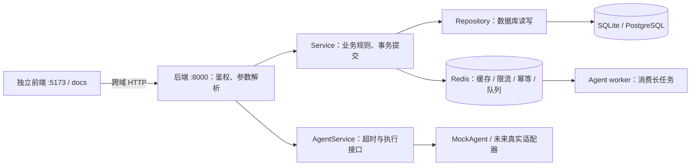

 # FastAPI 工程化学习 Demo

这是一个面向生产实践的后端参考项目：保留待办业务作为学习载体，加入配置、数据库、迁移、分层、鉴权、并发保护、日志、测试和容器部署，并为未来 Agent 接入定义接口。

它采用独立前端与后端 API 服务，已实现用户名注册／登录、可撤销的 Cookie 会话和按用户隔离的任务。账号流程与部署约束见 [账号与会话说明](docs/authentication.md)，Agent 演进见 [架构说明](docs/architecture.md)。这仍是生产实践参考，不包含完整账号运营或 Agent 平台。

## 1. 本地启动

项目采用 **前后端分离**：前端 http://127.0.0.1:5173/ ，后端 API http://127.0.0.1:8000 。后端根路径返回 404，不再托管页面。

- 点击「登录工作空间」注册或登录；首次注册后自动进入，刷新保持会话，账号面板可退出。未登录点击「新建任务」，登录成功后继续打开新建表单。
- 待办支持创建、编辑、完成/取消完成、删除确认、服务端筛选和分页；关键词搜索与统计仅针对当前页。
- 「Agent 实验室」连接现有调用接口，显示真实配置状态；默认执行器关闭，不会伪造 AI 回复。
- 支持桌面和手机布局、键盘操作、加载反馈及系统减少动态效果设置。

前端位于独立的 `frontend/` 工程，使用 Vite 管理开发和生产构建，独立 npm 依赖、锁文件与 Dockerfile。后端 `app/` 不包含前端文件，通过版本化 HTTP API 通信；两个服务可分别修改、构建和发布。

源码入口：`frontend/index.html`、`frontend/assets/app.js`；动画与主题在 `styles.css`，布局在 `layout.css`。账号只访问自己的任务；服务端负责验证归属。

前端修改前请先阅读 [Flowspace 前端设计规范](docs/frontend-design.md)，统一配色、排版、组件与动效；修改公共视觉规则时同步更新该文档。

**终端一：启动后端**。使用 Python 3.12，在项目根目录打开 PowerShell：

```powershell
python -m venv .venv
.\.venv\Scripts\python.exe -m pip install -r requirements-dev.lock
# 仅首次创建；不要覆盖已有配置
if (!(Test-Path .env)) { Copy-Item .env.example .env }
.\.venv\Scripts\python.exe -m alembic upgrade head
.\.venv\Scripts\python.exe -m uvicorn main:app --reload --no-access-log
```

**终端二：启动前端**。使用 Node.js 22.12+（建议 Node 24）：

```powershell
cd frontend
npm ci
if (!(Test-Path .env)) { Copy-Item .env.example .env }
npm run dev
```

打开 http://127.0.0.1:5173/ ，点击「登录工作空间」→「注册账号」。用户名为 3–32 位字母、数字或下划线，密码 6–128 字符，需包含至少一个英文字母。不再需要 API Key。

前端 `frontend/.env` 中的 `VITE_API_BASE_URL` 默认为 `http://127.0.0.1:8000`，必须是浏览器能够访问的后端地址，不能填 Docker 内网服务名。后端 `.env` 的 `CORS_ORIGINS` 默认允许 `http://127.0.0.1:5173` 和 `http://localhost:5173`；更换前端地址时同步配置。两边修改环境配置后都需重启。

前端生产构建：

```powershell
# 在 frontend 目录执行
npm test
npm run build
# 可选：本地检查构建产物，先停止占用 5173 的 dev 服务
npm run preview
```

构建输出为 `frontend/dist/`，可单独部署到 Nginx 或静态托管平台。`VITE_API_BASE_URL` 在构建时写入产物，变更时需要重新构建；所有 `VITE_` 配置对浏览器可见，不能放密钥。Vite preview 仅用于本地验收，生产使用静态服务器。

访问 http://127.0.0.1:8000/docs 阅读接口。在文档页先执行 auth/login 或 register 获取 Cookie，再将响应中的 csrf_token 填入写接口的 x-csrf-token 字段。数据与会话保存在 demo.db，服务重启不会丢失。按 Ctrl+C 停止服务。

环境变量优先于 `.env`。配置不符合生产规则时，应用会拒绝启动。不要提交 `.env`。文档页面使用 CDN 静态资源；离线时可用下面的 PowerShell 请求。

旧版 `/todos`、`/hello` 已被替换；现在业务接口统一使用 `/api/v1` 前缀，ID 改为 UUID，列表返回分页结构。

## 2. 跟着一条请求学习



建议按以下顺序读代码，每次只追踪一个操作：

1. `app/main.py`：工厂创建应用；lifespan 创建和释放数据库连接池；注册路由和错误处理。
2. `app/api/routes.py`：HTTP 方法、路径参数、查询参数、JSON 请求体和响应结构。
3. `app/api/dependencies.py`：Depends 注入鉴权和独立数据库 Session。
4. `app/schemas.py`：Pydantic 输入校验和输出契约，与数据库模型分别定义。
5. `app/services.py`：业务规则、版本冲突、事务提交；`app/repositories.py`：SQL 查询。
6. `app/models.py`、`migrations/`：数据库结构和可追踪的结构变更。
7. `tests/`：正常路径、错误路径和并发场景的可执行说明。

`async def` 配合异步数据库驱动避免阻塞事件循环。一个请求使用一个 Session；不要在多个并发任务中共享它。事务成功提交，异常或取消时未提交内容回滚。Agent 调用不占用数据库 Session。

## 3. 实际操作

| 方法与路径 | 行为 |
| --- | --- |
| GET `/api/v1/capabilities` | 公开文档地址和 Agent 模式，不含密钥 |
| GET `/health/live` | 进程存活；无需登录 |
| GET `/health/ready` | 数据库连接、表与迁移版本检查；无需登录 |
| POST `/api/v1/auth/register` | 注册并登录 |
| POST `/api/v1/auth/login` | 登录，设置 HttpOnly Cookie |
| GET `/api/v1/auth/me` | 当前用户与 CSRF 令牌 |
| POST `/api/v1/auth/logout` | 撤销当前会话 |
| POST `/api/v1/todos` | 创建待办，返回 201 |
| GET `/api/v1/todos?limit=20&offset=0&completed=false` | 有界分页和筛选 |
| GET `/api/v1/todos/{id}` | 读取待办 |
| PUT `/api/v1/todos/{id}` | 用版本号替换待办 |
| DELETE `/api/v1/todos/{id}?version=2` | 用版本号删除，返回 204 |
| POST `/api/v1/agent/invoke` | Agent 扩展入口，默认关闭 |
| POST `/api/v1/agent/runs` | 提交 Agent 长任务（202 + run_id），需 Redis |
| GET `/api/v1/agent/runs/{id}` | 查询长任务状态与结果 |
| GET `/api/v1/agent/runs/{id}/events` | SSE 订阅任务状态事件 |

命令行调用时，先用 `auth/login` 登录，将 Cookie 保存在 HTTP 客户端的会话中；把响应的 `csrf_token` 作为 `X-CSRF-Token` 请求头发送给写接口。不要把账号密码或 Cookie 放在 URL、日志、前端环境变量中。详见 [账号接口说明](docs/authentication.md)。

用刚创建任务的 ID 执行 PUT，请求体：

```json
{"title": "学会事务", "completed": true, "version": 1}
```

返回版本变成 2；再次提交旧版本 1 得到 409。客户端应重新读取记录，让用户决定如何处理冲突。PUT 是整体替换，省略 completed 会恢复 false。

故意尝试：空白标题、额外字段或 limit=101 得到 422；未登录或会话过期得到 401，缺少 CSRF 令牌的写请求得到 403；不存在的 UUID 得到 404。错误响应示例：

```json
{"error":{"code":"version_conflict","message":"记录已更新，请重新读取后再提交","details":null},"request_id":"..."}
```

`X-Request-ID` 将响应和 JSON 应用日志关联。日志不包含请求体、查询参数、密钥和模型提示词。TrustedHost 拒绝非法 Host 时由中间件直接返回 400 文本，这一边界错误不使用业务错误结构。

## 4. 体验 Agent 扩展边界

修改 `.env`：`AGENT_BACKEND=mock`，然后手动重启（修改环境文件不保证触发热重载）。调用 `/api/v1/agent/invoke`：

```json
{"prompt":"帮我分解学习 FastAPI 的步骤"}
```

返回内容明确标记 `provider=mock`，只是原样响应的模拟器，未调用模型、工具或外部网络。默认 disabled 返回 503；执行超时返回 504；未知执行器异常返回脱敏的 500。生产配置拒绝 mock。

真实 SDK、LangGraph 或其他框架应实现 `AgentRunner`，通过工厂注入。HTTP 层不依赖框架。长任务、流式输出、工具权限和预算的接入顺序详见 [架构说明](docs/architecture.md)。

## 4.1 Redis 加速与协调层

项目已接入 Redis（可选依赖，默认启用）。PostgreSQL 仍是唯一事实源，Redis 只承担四类职责：

| 能力 | 实现 | 降级策略 |
| --- | --- | --- |
| Todo 列表/详情缓存 | Cache-aside + 版本化键，写后 `INCR` 版本使旧 key 失效 | 缓存不可用回源数据库 |
| 认证会话缓存 | token digest 为 key，命中不再查库；登出即清除 | 回源 `login_sessions` 表 |
| 认证限流 | Lua 脚本 `INCR + EXPIRE` 原子计数，替代数据库嵌套事务 | 不可用时拒绝请求（fail-closed） |
| 幂等键 | `POST /todos` 的 `Idempotency-Key` 头，`SET NX EX` + 结果回放 | 不可用时拒绝写入 |
| Agent 长任务 | Streams 消费组队列 + 状态 Hash + SSE Pub/Sub；run 事实落 `agent_runs` 表 | 不可用时返回 503 |

配置（`.env`，环境变量优先）：

```
REDIS_URL=redis://:change-me@localhost:6379/0
REDIS_ENABLED=true
CACHE_TTL_SECONDS=60
SESSION_CACHE_TTL_SECONDS=300
IDEMPOTENCY_TTL_SECONDS=86400
```

生产环境强制 `REDIS_ENABLED=true`，且 `REDIS_URL` 必须是带认证的 `rediss://`（TLS）。Compose 已加入带 `requirepass` 与 AOF 持久化的 Redis 服务，并需要 `REDIS_PASSWORD` 环境变量。`/health/ready` 会检查 Redis 连通性。测试用进程内内存替身，无需真实 Redis；设计细节见 [Redis 接入方案](docs/redis-integration-plan.md)。

## 5. 测试与依赖

```powershell
.\.venv\Scripts\python.exe -m pytest -q
.\.venv\Scripts\python.exe -m ruff check .
.\.venv\Scripts\python.exe -m ruff format --check .
.\.venv\Scripts\python.exe -m pip check
```

测试默认使用临时 SQLite，每次真实执行 Alembic 迁移，不使用 create_all 绕过迁移。通过 `TEST_DATABASE_URL` 可在独立 PostgreSQL 测试库重跑同一套测试；测试会创建和删除表，绝不能指向开发或生产业务库。

`requirements.txt` / `requirements-dev.txt` 声明依赖范围；`requirements.lock` / `requirements-dev.lock` 固定本次解析的直接和间接依赖版本，Docker 和 CI 使用锁文件。锁文件是版本快照，不含包哈希；升级依赖后重新解析、测试并更新锁文件。

GitHub Actions 已配置独立前端 job（npm 测试、构建、前端镜像）和后端 job（代码规范、SQLite / PostgreSQL 测试、后端镜像）。只有将项目推到 GitHub 才会触发，这不是已经执行过的远程验证。

前后端分离后的验证记录见 [前后端分离说明](docs/frontend-backend-separation.md)。Docker 引擎可用时，另行验证两个镜像与 PostgreSQL 的完整容器链路。

如果 Windows 的系统临时目录报 PermissionError，可给测试指定项目内全新临时目录：

```powershell
New-Item -ItemType Directory -Path .test-runs -Force | Out-Null
$testRunPath = Join-Path (Get-Location).Path ('.test-runs/' + [guid]::NewGuid().ToString())
.\.venv\Scripts\python.exe -m pytest -q --basetemp $testRunPath
```

不要把 `--basetemp` 指向已有业务目录，pytest 会清理该目录。

## 6. 独立前端容器 + 后端 + PostgreSQL

先启动 Docker Desktop 的 Linux 引擎，在 PowerShell 为本机演示数据库生成密码：

```powershell
$env:POSTGRES_PASSWORD = python -c "import secrets; print(secrets.token_hex(24))"
docker compose up --build -d
docker compose ps
Invoke-RestMethod http://127.0.0.1:8000/health/ready
```

密钥需要安全保存；后续启动同一数据库卷时必须使用原密码，不要重新生成。Compose 通过环境变量传入密钥，生产平台应接入 Secret 管理。密码若自行设置，DATABASE_URL 中必须进行 URL 编码；上述十六进制生成方式无需额外编码。

前端容器独立启动，监听宿主机 5173，后端启动顺序：PostgreSQL 健康 → 单独执行迁移任务 → 启动 API（8000）。前端容器没有依赖后端启动条件，API 不可用时页面仍可展示并给出错误反馈。API 容器为非 root、只读文件系统，默认只绑定宿主机回环地址。Compose 默认 development 以支持本机 HTTP。正式部署设 APP_ENV=production，启用 HTTPS，Cookie 将强制 Secure，同时关闭 /docs 和 OpenAPI。

```powershell
docker compose logs api
docker compose down
```

`down` 保留数据库卷。不要使用 `down -v`，除非明确要销毁所有示例数据。新版本上线前应备份并单独执行迁移；不要让多个 API worker 同时运行迁移。

公开部署时使用同一站点下的独立域名（例如 app.example.com 与 api.example.com），分别配置 HTTPS、请求体限制、速率限制和超时，并更新后端 ALLOWED_HOSTS、CORS_ORIGINS 与前端构建参数 VITE_API_BASE_URL。HTTPS 页面不能请求 HTTP 后端。若需要信任代理头，只允许受信任代理地址。当前项目没有实现这些平台设施，也没有进行容量压测或安全审计。

## 7. 下一步练习

先为 Todo 增加 description：修改 schema/model → 生成迁移 → 检查迁移 → upgrade → 补测试。迁移命令：

```powershell
.\.venv\Scripts\python.exe -m alembic revision --autogenerate -m add_description
.\.venv\Scripts\python.exe -m alembic upgrade head
```

新增迁移后同步更新就绪检查中的预期 schema revision（当前为 0003），并运行迁移一致性测试。用户身份与资源归属已落地；下一阶段可补账号找回、OIDC，然后接真实 Agent 和任务系统。
