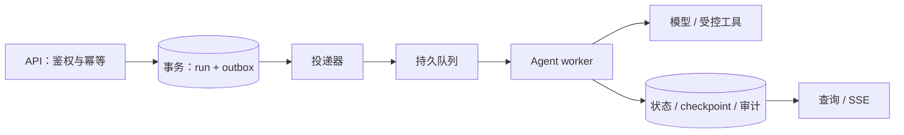

# 架构决策与 Agent 演进

## 部署边界

前端位于 `frontend/`，通过 Vite 独立开发构建，生产由独立 Nginx 容器提供静态文件。后端 `app/` 只提供 API、健康检查及开发文档，不托管前端。前端直连配置的 API 地址，后端通过明确的 CORS origin 白名单开放浏览器访问。两侧独立依赖、CI job 和 Dockerfile；后端内部仍采用分层单体，不等于微服务。详见 [前后端分离说明](frontend-backend-separation.md)。

## 目标与范围

目标是能读懂、能运行、能测试、能部署的工程化单体参考实现。保留一个 Todo 业务领域，避免在学习阶段引入微服务、通用 CRUD 基类和复杂插件注册系统。每个目录承担明确责任，而不是用文件数量代表工程质量。

| 当前已实现 | 尚未实现 |
| --- | --- |
| 应用工厂、环境配置与生产启动校验 | OIDC、团队租户、角色授权与账号找回 |
| 异步 SQLAlchemy、独立 Session、事务、UUID | 数据库备份平台、自动故障切换 |
| Alembic 迁移、独立迁移任务 | 在线迁移编排与自动回滚平台 |
| 账号会话、个人任务隔离、认证限流、分页、乐观锁 | 全站网关限流、业务审计存储 |
| 请求 ID、脱敏 JSON 日志、健康检查 | Prometheus 指标、OpenTelemetry trace 后端与告警 |
| Redis 缓存、会话缓存、Lua 原子限流、幂等键、Agent 任务队列与 SSE | 真实模型、工具执行、RAG、记忆 |
| Agent 协议、模拟适配器、异步超时 | 真实模型适配器 |
| SQLite 自动测试、PostgreSQL CI 配置、容器文件 | 本次环境中的 PostgreSQL / 容器实测与负载测试 |

## 为什么这样分层

- API 层负责协议：从 URL、Header、Body 获取输入并声明响应，不写 SQL。
- Service 层负责业务：检查资源、处理并发版本、决定提交时机。未来 Agent 工具也应调用 Service，通过同样的权限检查，不绕过业务层直接改数据库。
- Repository 层负责持久化查询，不自行提交事务。
- Pydantic schema 是 API 契约；SQLAlchemy model 是数据库表示。两者分离，避免数据库结构变化直接扩散到客户端。
- Settings 只在工厂/入口解析；测试显式注入设置，模块导入不创建连接或读取业务数据。

应用生命周期管理数据库引擎，依赖注入管理每个请求的 Session。提交发生在返回响应之前；退出 Session 时未提交事务回滚。每个异步任务必须使用自己的 Session，参见 [SQLAlchemy 官方并发说明](https://docs.sqlalchemy.org/en/20/orm/extensions/asyncio.html#using-asyncsession-with-concurrent-tasks)。

## 数据与一致性

生产使用 PostgreSQL，SQLite 用于本地启动和快测。二者不保证所有锁行为一致，因此 CI 使用 PostgreSQL 重跑测试。账号通过服务端会话认证，TodoRepository 必须接收当前用户 ID，列表与单条读写均按 owner_id 过滤；请求体不能指定归属。迁移前的 NULL owner_id 任务保留但不可由普通账号访问。参见 [账号与会话说明](authentication.md)。

记录包含 version。客户端提交上次读到的版本，Service 先检查，SQLAlchemy 再把版本加入 UPDATE / DELETE 条件，捕获检查和提交之间的竞态。冲突返回 409。创建接口尚未提供幂等键，网络超时后的盲目重试可能创建重复记录；客户端应先查询确认或在后续引入幂等键表。

分页使用稳定排序与有界 offset；高数据量或需要一致翻页时再换游标分页。迁移是部署阶段的单独任务，不在每个 worker 启动时执行，符合 [FastAPI 部署建议](https://fastapi.tiangolo.com/deployment/concepts/)。Alembic 通过异步连接的 run_sync 执行迁移，参考 [官方 cookbook](https://alembic.sqlalchemy.org/en/latest/cookbook.html#using-asyncio-with-alembic)。

## Agent 接入顺序

### 阶段一：短时、无副作用调用

实现 `AgentRunner.run(prompt, request_id=...)` 的异步适配器，在 lifespan 创建可复用客户端并在 shutdown 关闭。配置增加 provider、模型名称和 SecretStr 密钥。适配器输出稳定的 AgentResponse，保持 HTTP 层不依赖 SDK。同步 SDK 应显式隔离到线程或进程；当前 asyncio 超时依赖协作取消，无法强制终止阻塞线程或 CPU 计算。

为真实模型增加连接/读取超时、最大输入输出 token、成本预算和并发上限。只对明确可重试且无副作用的失败进行有限退避；不自动重试工具写操作。默认日志继续不记录 prompt 和模型输出。外部限流、模型不可用等错误在适配器映射为稳定错误码。

### 阶段二：身份、权限与工具

现有用户身份和个人任务归属可供未来工具调用复用。开放工具时，必须把认证得到的 user_id 传入 Service；团队场景另行扩展 tenant_id 和角色，不信任请求体或模型自报身份。工具采用显式白名单、输入 schema、最小权限和执行审计；写入、发送、删除等副作用根据产品规则进行确认。外部网页、检索内容和模型输出都是不可信输入，不能修改工具权限或系统指令。

### 阶段三：持久化长任务

新增 `POST /api/v1/agent/runs` 返回 202 和 run_id；GET 查询状态；取消使用独立命令。任务表保存 owner、状态、版本、deadline、幂等键、预算、错误码和时间戳，不只放在进程内字典中。队列中只传 run_id，worker 自行读取授权上下文。

状态机建议 queued → running → succeeded / failed / cancelled，worker 使用租约与心跳处理崩溃恢复。outbox 解决“数据库写成功但消息没发出去”的双写问题。队列按至少一次投递设计，工具副作用必须幂等；不要声称 exactly-once。取消先持久化标记，再由 worker 在安全检查点停止，不能保证撤销已经发生的外部副作用。

框架 checkpoint 和业务 run 状态分开存储。SSE 是状态/事件的展示通道，断开浏览器不应丢失任务；事件要带序号，支持重连和权限校验。不要用 FastAPI BackgroundTasks 承担需要重启恢复的长任务。

### 阶段四：质量与运营

模型接入后建立固定评测集，测成功率、工具调用准确性、超时、token 和成本。记录 run_id / request_id / trace_id 的关联，指标不使用 prompt、用户 ID 等高基数标签。向量库、记忆和 RAG 在有明确需求后接入；同时设计文档访问控制、删除和保留周期。

## 部署验收

对外上线前需要结合真实平台完成 HTTPS、密钥轮换、网关限流与请求大小限制、最小权限数据库账号、备份恢复演练、依赖审计、故障告警和容量压测。Dockerfile 使用非 root 和 exec 启动形式；Compose 是本机部署示例，不是高可用集群。镜像 tag 和 Python 依赖版本虽已约束，供应链严格环境仍需固定镜像 digest、包哈希及扫描策略。

当前错误日志仅记录异常类型，避免把数据库参数或 SDK 密钥写入日志。上线后可接入具备字段脱敏能力的错误追踪服务，保留安全的堆栈定位信息。生产中不要开启 SQL echo 或原始请求体日志。
