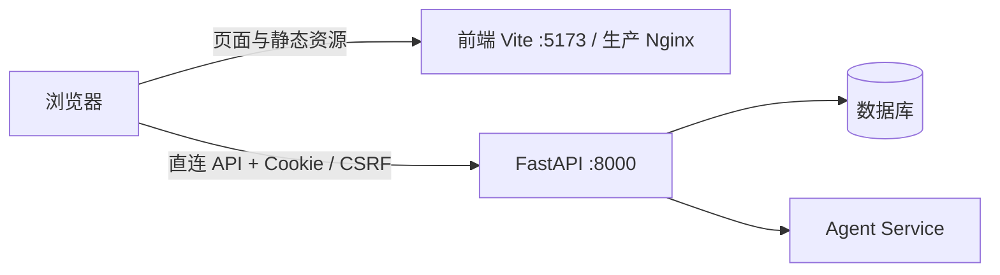

# 前后端分离说明与验证记录

更新日期：2026-11-22。

## 当前结构

```text
FastAPI_demo/
├── frontend/                 # 独立前端工程
│   ├── index.html            # 页面入口
│   ├── assets/               # 页面交互、API 客户端、样式与图标
│   │   ├── config.js         # API origin 校验与 URL 拼接
│   │   ├── api.js            # Cookie 会话请求与 CSRF 头
│   │   └── ...
│   ├── tests/                # 前端配置边界测试
│   ├── package.json
│   ├── package-lock.json     # 前端依赖锁文件
│   ├── vite.config.js        # 开发、预览和构建配置
│   ├── .env.example          # 公开的后端地址示例
│   ├── Dockerfile            # 独立前端镜像：构建 + Nginx
│   ├── nginx.conf            # 静态资源服务
│   └── dist/                 # 构建产物，不提交
├── app/                      # 后端业务代码，不再包含 web 目录
├── main.py                   # 后端启动入口
├── migrations/               # 后端数据库迁移
├── tests/                    # 后端业务与 CORS 测试
├── requirements*.txt/lock    # 后端依赖
├── Dockerfile                # 后端镜像，只包含 Python 应用
└── compose.yaml              # 组合启动，仍是两个独立应用容器
```

后端保留根目录的启动、迁移、依赖和数据库路径，避免无必要地迁移已有数据。它和 `frontend/` 已具有独立依赖、运行进程、构建产物及镜像；不是把静态文件换个目录后仍由 FastAPI 提供。

## 运行与请求流向



本地在两个终端分别运行：

```powershell
# 终端一：项目根目录
.\.venv\Scripts\python.exe -m uvicorn main:app --host 127.0.0.1 --port 8000 --reload --no-access-log
```

```powershell
# 终端二：项目根目录
cd frontend
npm ci
npm run dev
```

浏览器访问 http://127.0.0.1:5173/ ，API 文档仍在 http://127.0.0.1:8000/docs 。后端 `/`、`/assets/*`、旧 `/ui-config` 均不再提供页面或资源；公开能力接口迁至 `/api/v1/capabilities`。

前端没有设置 API 开发代理，浏览器确实向另一个 origin 发出请求，开发和独立域名部署都依赖后端 CORS 配置。

## 配置边界

| 配置 | 所在位置 | 用途 |
| --- | --- | --- |
| `VITE_API_BASE_URL` | `frontend/.env` 或构建环境变量 | 浏览器可以访问的 API origin，默认 `http://127.0.0.1:8000` |
| `CORS_ORIGINS` | 后端根目录 `.env` 或服务环境变量 | 允许的前端 origin JSON 数组，默认 localhost 与 127.0.0.1 的 5173 端口 |
| `ALLOWED_HOSTS` | 后端配置 | API 服务自身接受的 Host；与前端 CORS origin 不同 |
| `SESSION_HOURS` | 仅后端配置 | 会话绝对有效期，默认 8 小时 |

URL 使用完整 origin（协议、域名、端口），不包含路径或末尾斜杠；前端配置允许输入末尾斜杠并会规范化。更改 Vite 配置需重启开发服务；部署时更改 API origin 需重建前端。

`VITE_` 变量最终会出现在浏览器可下载的代码中，不是秘密存储。此行为参见 [Vite 环境变量文档](https://vite.dev/guide/env-and-mode)。

后端仅开放 GET / POST / PUT / DELETE 与 Content-Type、X-CSRF-Token 请求头，并允许前端读取 X-Request-ID。401、业务错误以及脱敏 500 均能跨域返回，避免被浏览器掩盖为模糊的网络错误。未授权 origin 不获得允许读取的 CORS 响应头，预检被拒绝；CORS 本身不替代 API 鉴权，也不阻止非浏览器客户端。参见 [FastAPI CORS 文档](https://fastapi.tiangolo.com/tutorial/cors/)。

## 独立部署

前端在 `frontend/` 执行 `npm run build`，得到 `dist/`；生产镜像使用独立非 root Nginx 提供静态文件。Vite dev / preview 只用于开发与验收。

后端镜像只复制 Python 应用、迁移与运行依赖，不安装 Node，也不包含前端源码或 dist。前端镜像不包含后端 `.env`、数据库或 Python 环境。

Compose 是编排便利入口，前端服务不依赖 API 启动：API 故障时前端仍可显示页面及服务未就绪提示。对外发布可分别部署前端与 API，只需配置对应地址和 CORS；生产公开域名应使用 HTTPS，并将 Nginx CSP 的 connect-src 从通用 HTTP(S) 收紧到实际 API 域名。

Compose 本地映射：前端 `127.0.0.1:5173 → 容器8080`，API `127.0.0.1:8000 → 容器8000`。`VITE_API_BASE_URL` 是浏览器访问地址，不能填写仅容器可解析的 `http://api:8000`。

GitHub Actions 分成独立 frontend 与 test（后端）job：前端 npm ci、测试、构建与前端镜像；后端 Python 检查、SQLite / PostgreSQL 测试与后端镜像。

## 分离改造时的历史验证（账号改造前）

| 验证项 | 结果 |
| --- | --- |
| 后端 pytest | 23 项通过；包含既有业务与新增 CORS 边界 |
| 前端 npm test | 2 项通过；地址拼接和不安全配置拒绝 |
| 前端 npm run build | 成功生成 HTML、带内容哈希的 JS / CSS / SVG |
| 浏览器访问独立 5173 首页 | 成功，服务健康状态可读取 |
| 浏览器错误密钥 | 显示明确的 API Key 错误，非 CORS 网络错误 |
| 浏览器正确密钥 | 成功连接并读取任务列表 |
| 浏览器跨域 POST / PUT / DELETE | 创建临时任务、标记完成、删除均成功；临时数据已清理 |
| 文档入口 | 正确指向后端 8000/docs |
| Compose 配置 | `docker compose config --quiet` 通过 |
| 容器镜像与 PostgreSQL 完整运行 | 未执行：本机 Docker Linux 引擎未启动 |

以下历史记录中的 API Key 流程已被账号登录替换；当前验证见 [账号说明](authentication.md)。

历史验证证明独立开发服务、API 通信和前端构建可用；不等同于已完成生产容量测试或容器环境验收。

## 后续修改规则

- 改页面：进入 `frontend/`，修改后使用 Vite 热更新；视觉规则见 [前端设计规范](frontend-design.md)。
- 改业务：修改 `app/` 与对应后端测试；接口变更同步前端 API 客户端。
- 改数据结构：继续由后端 Alembic 管理，不让前端直接访问数据库。
- 改部署域名：同步前端 API 构建参数、后端 Host 白名单与前端 origin 白名单。
- 保持 `/api/v1` 契约稳定。前后端独立发布后，接口兼容性比同时部署时更重要。

## Cookie 部署约束

前后端仍可独立发布，但应属于同一站点，例如 HTTPS 的 app.example.com 和 api.example.com。本地两端统一使用 127.0.0.1，不能前端 localhost、后端 127.0.0.1 混用。客户端 credentials:include，服务端精确 CORS 白名单并允许 credentials；SameSite=Lax 不支持无关站点之间的 Cookie 认证。
